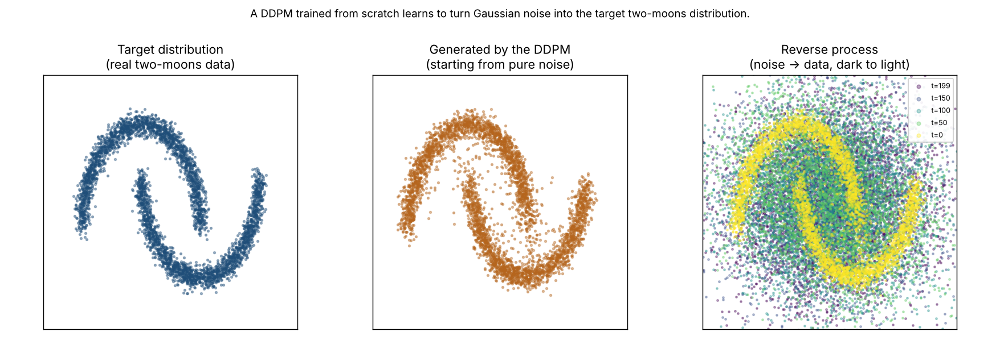

# A DDPM from scratch (2-D)

[](https://github.com/hager-safwat/ddpm-from-scratch/actions/workflows/tests.yml)

[](LICENSE)

A minimal, tested implementation of a **Denoising Diffusion Probabilistic
Model** (Ho et al., 2020), trained to generate samples from a 2-D toy
distribution: two interleaving moons.

Keeping it in 2-D makes the whole method visible: the forward process that
turns data into noise, the network that learns to predict that noise, and the
reverse process that turns noise back into data. The same machinery scales to
images; only the noise-prediction network changes (an MLP here, a U-Net for
images).



## How it works

**Forward process (fixed, no learning).** Starting from a real point `x0`,
Gaussian noise is added in `T` small steps. A closed form jumps straight to
any step `t`:

```
x_t = sqrt(alpha_bar_t) * x0 + sqrt(1 - alpha_bar_t) * eps,     eps ~ N(0, I)
```

where `alpha_bar_t` is the cumulative product of `(1 - beta)` up to step `t`.

**Reverse process (learned).** A network `eps_theta(x_t, t)` is trained to
predict the noise that was added, with a plain MSE loss. Sampling starts from
pure noise and walks backwards step by step (ancestral sampling), removing a
little predicted noise and adding a little fresh noise at each step.

The timestep `t` reaches the network through a sinusoidal embedding (the same
idea as Transformer positional encodings).

### The noise schedule

The original betas (1e-4 to 0.02) were designed for `T = 1000`. With
`T = 200` they leave `alpha_bar_T = 0.13`: after the full forward process 36 %
of the signal is still there, while sampling assumes pure noise. This code
rescales the betas by `1000 / T` (0.0005 to 0.1), which brings
`alpha_bar_T` to about 4e-5 and makes training and sampling consistent. For
very small `T` the betas are capped at 0.999. The original schedule is still
available with `--unscaled-schedule`.

## Setup and results

| | |
|---|---|
| Data | 4000 points, two moons, Gaussian jitter 0.06, standardised |
| Network | MLP, 3 hidden layers of 256, SiLU, 64-dim time embedding (149,250 parameters) |
| Diffusion | `T = 200`, linear betas 0.0005 to 0.1 |
| Training | Adam, lr 1e-3, batch 512, 15,000 steps |

Quality is measured with the mean nearest-neighbour distance between point
clouds (standardised units, lower is better). As a floor, the same distance
between two independent draws of real data is 0.0164: a perfect generator
would score about that.

| Run (seed 0) | generated to real (precision) | real to generated (coverage) | spread x / y (real: 1.000) |
|---|---|---|---|
| Rescaled schedule (default) | 0.0253 | 0.0179 | 0.986 / 0.969 |
| Original schedule (`--unscaled-schedule`) | 0.0208 | 0.0166 | 0.956 / 0.994 |
| Real data, fresh draw (floor) | 0.0164 | | |

Both runs land close to the floor, so the model reproduces the distribution
rather than collapsing to a blob. The difference between the two schedules is
small and comes from a single seed, so it should not be read as one being
better. The rescaled schedule is the default because it is the
self-consistent one, not because it scored higher here.

## Run it

```bash
git clone https://github.com/hager-safwat/ddpm-from-scratch.git
cd ddpm-from-scratch
pip install -e ".[demo]"
python ddpm_demo.py
```

The full run takes about 5 minutes on a laptop CPU (measured: 5 min 40 s on
a 2-core cloud machine). It prints the training loss and the metrics above
and regenerates `figure.png`. Quick check: `python ddpm_demo.py --steps 300 --no-figure`.

## Tests

```bash
pip install -e ".[dev]"
pytest -v
```

The tests check the mathematics, not only that the code runs:

| Test | What it verifies |
|---|---|
| `test_closed_form_matches_step_by_step_forward_process` | applying the one-step noising 31 times gives the same mean and variance as the closed form (200,000 samples) |
| `test_scaled_schedule_destroys_the_signal` | `alpha_bar_T` < 1e-3 with rescaling, 0.132 without |
| `test_betas_stay_below_one_for_small_T` | the rescaled schedule stays valid for T = 5, 20, 50 |
| `test_sampling_shape_snapshots_and_reproducibility` | same seed, same samples; snapshots at the expected steps |
| plus data, model, training, metric and smoke tests | |

Every push and pull request runs `ruff` and the tests on Python 3.10 and 3.12.

## Repository structure

```
ddpm/
    data.py        two-moons data
    schedule.py    noise schedule and closed-form forward process
    model.py       time embedding and noise-prediction MLP
    diffusion.py   training loop, ancestral sampling, nearest-neighbour metric
ddpm_demo.py       experiment, metrics and figure
tests/             pytest suite
```

## Scope

This is a **mechanism demo on synthetic data**: the smallest complete DDPM
that still shows every moving part. It is not a benchmark. The technique comes
from my master's work, where I used a denoising diffusion model on an
image-based problem; this repository reimplements the core method from
scratch on toy data, with no project data involved.

## Reference

- J. Ho, A. Jain, P. Abbeel, *Denoising Diffusion Probabilistic Models*,
  NeurIPS 2020.
- A. Nichol, P. Dhariwal, *Improved Denoising Diffusion Probabilistic Models*,
  ICML 2021 (beta cap).

## License

MIT, see [LICENSE](LICENSE).
